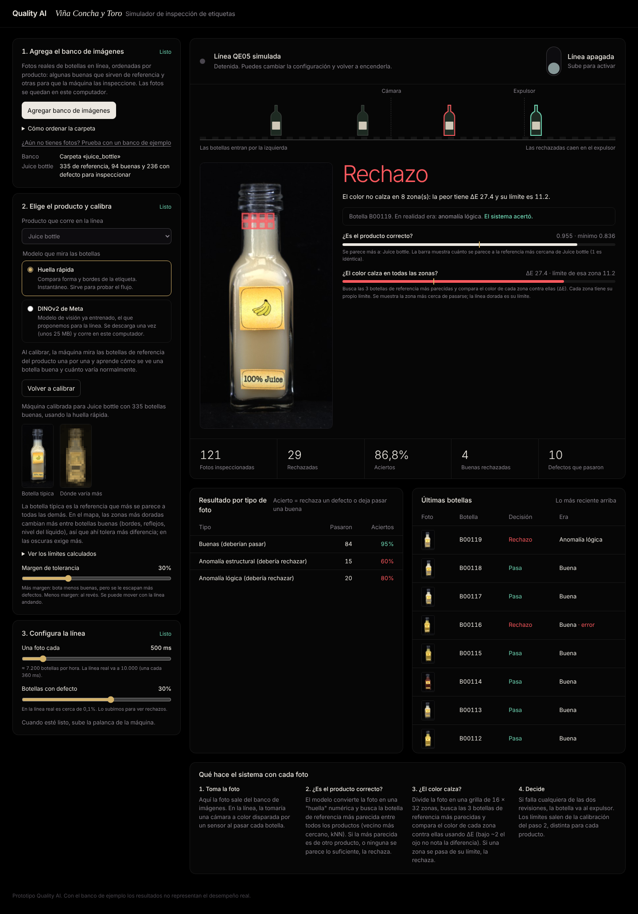
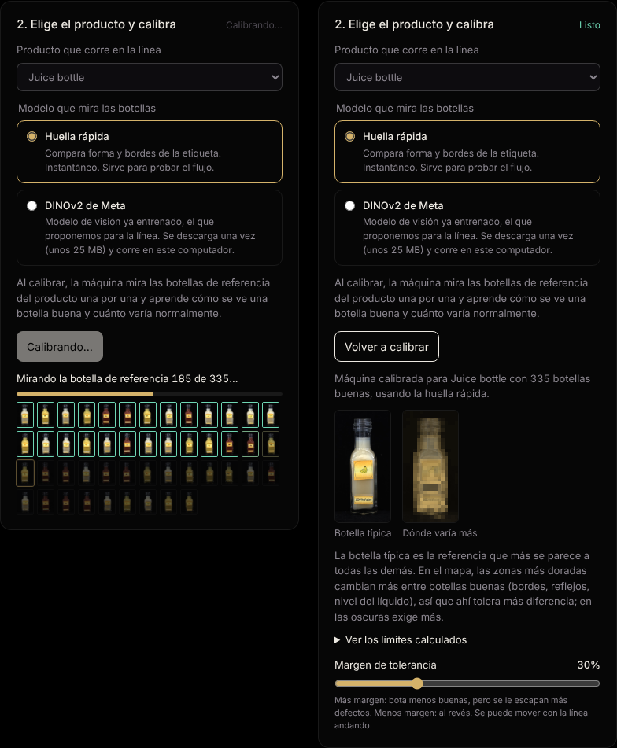
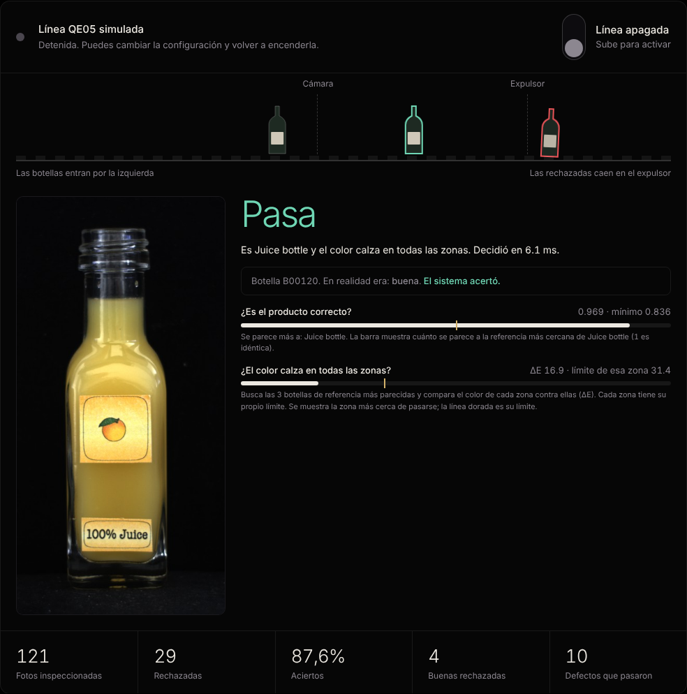

# Quality AI — Inspección de etiquetas con IA

Proyecto con **Viña Concha y Toro** para sumar una capa de inteligencia artificial a la inspección de etiquetas de la línea QE05, donde hoy trabaja una FT System IE4000. La máquina actual cumple bien con la presencia y la posición de la etiqueta, pero se equivoca con el **color** y con la **coincidencia del diseño**. Este repo es el prototipo de un software que mira la foto de cada botella y decide si pasa o se rechaza.



---

## En qué estamos

**Listo**

- ✅ Simulador de la línea que corre en el navegador, con cinta, cámara, expulsor y una palanca para encenderla.
- ✅ Inspección real sobre cada foto: el resultado no se inventa, se calcula.
- ✅ Dos revisiones por botella: ¿es el producto correcto? y ¿el color calza en todas las zonas?
- ✅ Calibración automática con fotos de botellas buenas, sin entrenar ningún modelo.
- ✅ Varios productos en un mismo banco, cada uno con su propia calibración. Si pasa una botella de otro producto, se rechaza.
- ✅ Dos modelos a elegir: huella rápida o DINOv2 de Meta (corre en el navegador).
- ✅ Perilla de margen de tolerancia para ver en vivo el equilibrio entre botar buenas y dejar pasar defectos.
- ✅ Métricas de aciertos, buenas rechazadas y defectos que pasaron, por tipo de defecto.
- ✅ Probado con un banco público de fotos reales de botellas (MVTec LOCO AD, *juice_bottle*).
- ✅ Pipeline en Python con la misma lógica (galería, calibración, evaluación y simulación de cadencia).

**Pendiente**

- ⬜ Fotos reales de la línea de Concha y Toro: referencias por SKU y rechazos etiquetados por calidad.
- ⬜ Probar DINOv2 con el banco real y compararlo con la huella rápida (ya está integrado, falta medirlo).
- ⬜ Llevar al pipeline de Python la comparación por grilla contra las 3 referencias más parecidas (hoy está solo en el simulador).
- ⬜ Alinear la etiqueta antes de comparar, para cuando la botella llega girada o corrida.
- ⬜ Resolver las botellas no orientadas: más de una cámara o espejos.
- ⬜ Confirmar si la FT System entrega imágenes a color y en tiempo real.
- ⬜ Cámara industrial a color, iluminación controlada y señal al expulsor (PLC).
- ⬜ Piloto en modo sombra en la línea, comparando contra las decisiones de la FT.

---

## El banco de imágenes que usamos

Mientras llegan las fotos de la viña, probamos con **MVTec LOCO AD**, categoría **juice_bottle**. Es un banco público de fotos tomadas con cámara industrial, pensado justamente para probar inspección visual. Son botellas con jugo de naranja, plátano o cereza, cada una con una etiqueta de fruta y otra que dice "100% Juice".

| Carpeta | Fotos | Qué son |
|---|---|---|
| `train/good` | 335 | Botellas buenas, usadas como referencia |
| `test/good` | 94 | Botellas buenas para inspeccionar |
| `test/logical_anomalies` | 142 | Defectos "lógicos": etiqueta de una fruta que no corresponde al jugo, etiqueta faltante, líquido de más o de menos |
| `test/structural_anomalies` | 94 | Defectos físicos: etiqueta dañada o corrida, contaminación, botella defectuosa |

Para nosotros, el defecto lógico más importante es la **etiqueta que no calza con el producto**, que equivale a poner la etiqueta de un Cabernet en un Chardonnay.

El banco no está dentro del repo, porque pesa ~630 MB. Está en la carpeta hermana `../Banco de imagenes/juice_bottle`. Se descarga desde [mvtec.com](https://www.mvtec.com/company/research/datasets/mvtec-loco/downloads). La licencia es CC BY-NC-SA 4.0 (solo uso no comercial), y si se usa en un informe hay que citar: *Bergmann et al., "Beyond Dents and Scratches: Logical Constraints in Unsupervised Anomaly Detection and Localization", IJCV 2022.*

### Cómo le va

Medido sobre todas las fotos de `test/` con la huella rápida:

| Margen de tolerancia | Buenas rechazadas | Defectos lógicos detectados | Defectos estructurales detectados |
|---|---|---|---|
| 0% (estricto) | 27% | 96% | 79% |
| **30% (por defecto)** | **5%** | **85%** | **62%** |
| 60% | 0% | 73% | 49% |
| 100% (holgado) | 0% | 59% | 45% |

Se lee así: con el margen por defecto, de cada 100 botellas buenas se botan 5, y de cada 100 con la etiqueta equivocada se detectan 85. Es un buen punto de partida para un método que no entrena nada, pero todavía no alcanza para producción. Los defectos estructurales chicos son los que más se le escapan. El siguiente paso es medir lo mismo con DINOv2.

---

## Cómo funciona por dentro

Piénsalo como un catador al que le das cientos de copas del mismo vino bueno. No aprende "el sabor perfecto": aprende **cuánto varía normalmente** una copa buena. Después, si una copa se sale de esa variación, la marca.

Por cada botella, el sistema hace dos revisiones. Si falla cualquiera de las dos, la botella se rechaza.

**1. ¿Es el producto correcto?**
El modelo convierte la foto en una **huella**, que es una lista de números que resume cómo se ve la etiqueta. Después busca, entre todas las botellas de referencia de todos los productos, la que tiene la huella más parecida. Esto se llama **vecino más cercano (kNN)**.
- Si la más parecida es de otro producto, la rechaza: "Parece ser Casillero Merlot, no Frontera Chardonnay".
- Si es del producto correcto pero se parece poco, también la rechaza.

El kNN se usa siempre. Lo que cambia según el modelo elegido es cómo se calcula la huella:
- **Huella rápida:** tonos de gris y bordes de la foto. Es instantánea, pero bastante simple.
- **DINOv2 (Meta):** una red neuronal de visión ya entrenada con millones de imágenes, que entiende formas y diseños. No hay que entrenarla. Es la que proponemos para la línea.

**2. ¿El color calza?**
La foto se divide en una grilla de 16 x 32 zonas. El sistema busca las **3 botellas de referencia más parecidas** a la foto (otra vez kNN) y compara el color de cada zona contra ellas, usando la diferencia de color que percibe el ojo:

```
ΔE = raíz( (L1 − L2)² + (a1 − a2)² + (b1 − b2)² )
```

Bajo ~2 el ojo no nota la diferencia. Comparar contra las más parecidas, y no contra un promedio, es lo que permite que un mismo producto tenga variantes, como los tres jugos del banco, o distintas cosechas.

**La calibración** fija los límites:
1. Cada referencia se compara contra las demás, como si fuera una botella nueva.
2. Se anota cuánto varió cada zona en las botellas buenas. Los bordes, reflejos y el nivel del líquido varían mucho; el centro de la etiqueta varía poco.
3. El límite de cada zona queda en esa variación más el margen de tolerancia, con un mínimo de ΔE 3.

Al calibrar se ve la **botella típica** del producto y un mapa de **dónde varía más**.

---

## Cómo usarlo

### 1. Abrir el simulador

Desde CMD, en la carpeta del repo:

```cmd
cd "C:\Users\Joaquin\Desktop\Ramos\IPre IA\Repositorio\Proyecto-IA-en-Calidad-CyT"
python -m http.server 8000
```

Después entra a **http://localhost:8000/frontend/** en Chrome o Edge. También se puede abrir `frontend\index.html` con doble clic, pero con el servidor el navegador guarda DINOv2 y no lo vuelve a descargar.

### 2. Agregar el banco de imágenes

Aprieta **Agregar banco de imágenes** y elige la carpeta `Banco de imagenes\juice_bottle`. El sistema separa solo las fotos de referencia y las fotos para inspeccionar. Si no tienes fotos a mano, el link de abajo carga un banco de ejemplo dibujado, que sirve para ver el flujo pero no para medir.

### 3. Elegir producto, modelo y calibrar

Elige qué producto corre en la línea y con qué modelo mirar las botellas. Después aprieta **Calibrar**. Vas a ver cómo recorre las referencias y, al final, la ficha del producto.



La perilla de **margen de tolerancia** se puede mover en cualquier momento, incluso con la línea andando.

### 4. Configurar y encender la línea

Elige cada cuántos milisegundos pasa una botella y qué porcentaje viene con defecto. En la realidad es cerca de 0,1%, pero conviene subirlo para ver rechazos. Después **sube la palanca**.



Por cada botella vas a ver:
- la foto, con las zonas de color que no calzan marcadas en rojo,
- la decisión y el motivo,
- qué era en realidad y si el sistema acertó.

Abajo hay un resumen por tipo de defecto y las últimas botellas.

### 5. Usar fotos propias

Ordena la carpeta así, con una subcarpeta por producto:

```
banco/
  Frontera Chardonnay/
    maestras/          botellas buenas de referencia (ojalá 100 o más, de distintos turnos)
    test/ok/           buenas para inspeccionar
    test/<defecto>/    una carpeta por tipo de defecto, el nombre es el tipo
  Casillero Merlot/
    ...
```

---

## Parte en Python

La misma lógica también existe como pipeline en Python, para cuando se conecte a una cámara real:

```bash
pip install -r requirements.txt                     # para DINOv2 también: torch y torchvision
python scripts/import_mvtec_loco.py "../Banco de imagenes/juice_bottle"
python scripts/build_gallery.py                     # huellas y color patrón por SKU
python scripts/calibrate.py                         # límites por SKU
python scripts/evaluate.py                          # compara: solo SKU / solo color / ambas
python scripts/simulate_line.py 300 10000 JUICE_BOTTLE   # cadencia real: ¿alcanza a decidir a tiempo?
```

Hay un detalle: el pipeline de Python todavía usa zonas de color fijas por SKU (`configs/skus/*.yaml`). El simulador ya usa la grilla con las 3 referencias más parecidas, que funcionó mejor. Llevar eso a Python está pendiente.

## Estructura

```
frontend/index.html        simulador (todo en un archivo, sin instalar nada)
src/inspector/             embedder, galería, revisiones de SKU y color, pipeline
scripts/                   importar banco, calibrar, evaluar, simular cadencia
configs/                   configuración de la línea y recetas por SKU
docs/                      capturas para este README
```
